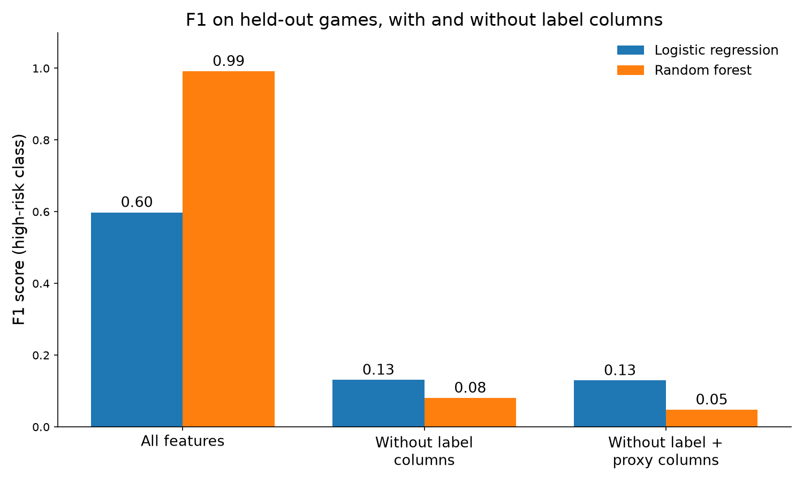
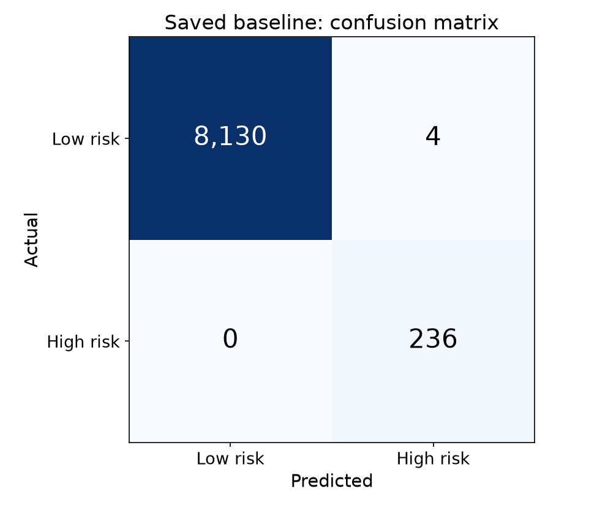
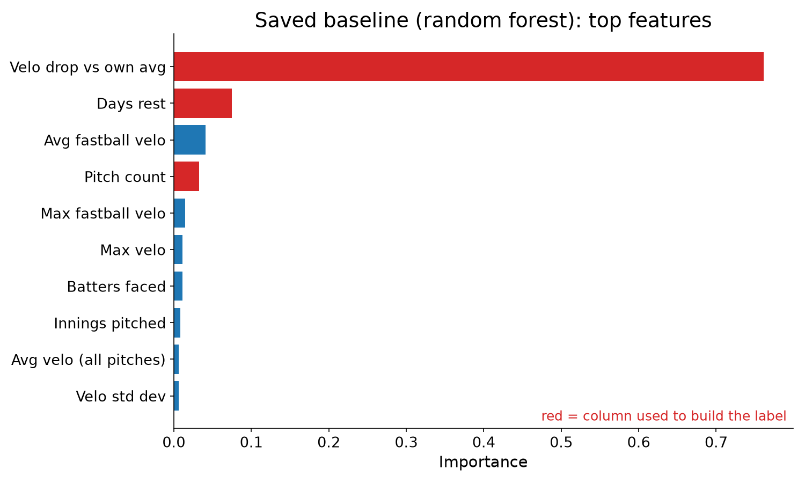

# Baseline risk model evaluation (SCRUM-49)

Evaluation of the baseline high-risk classifier from SCRUM-28 (`ml/train_baseline.py`,
saved model `ml/models/baseline_risk.joblib`).

## Data

- Cleaned Statcast pitcher games for the 2024 and 2025 regular seasons, built with the repo
  pipeline (`collect_statcast` then `clean_statcast`). The full data is gitignored, so it has
  to be downloaded locally first. The committed 500-row sample is too small to evaluate on
  (only 3 high-risk games end up in its test split).
- 41,349 games after dropping position players (avg velo under 75). This is a little more
  than the 41,126 in `baseline_metrics.json`, most likely because Statcast data was updated
  since the model was trained. Metrics still match the saved ones within 0.005.
- Same time-based split as training: first 80% of games by date for training (32,979),
  last 20% for testing (8,370).
- High-risk share: 3.2% overall, 2.8% in the test set.

## Label

A game is labeled high risk when at least 2 of these are true:
pitch count >= 95, days rest <= 3, velo drop >= 1.5 mph (fastball velo below the
pitcher's own earlier average).

## Results on held-out games

| Model | Features | Accuracy | Precision | Recall | F1 | ROC AUC |
|---|---|---|---|---|---|---|
| Always "low risk" (dummy) | any | 0.972 | 0.000 | 0.000 | 0.000 | 0.500 |
| Logistic regression | all | 0.962 | 0.427 | 1.000 | 0.598 | 0.991 |
| **Random forest (saved baseline)** | all | 0.9995 | 0.983 | 1.000 | **0.992** | 0.9998 |
| Logistic regression | no label columns | 0.755 | 0.073 | 0.653 | 0.131 | 0.789 |
| Random forest | no label columns | 0.970 | 0.297 | 0.047 | 0.081 | 0.856 |
| Logistic regression | no label or proxy columns | 0.730 | 0.071 | 0.712 | 0.129 | 0.781 |
| Random forest | no label or proxy columns | 0.971 | 0.375 | 0.025 | 0.048 | 0.804 |

"Label columns" = pitch_count, days_rest, velo_drop. "Proxy columns" = batters_faced,
innings_pitched_approx, avg_fastball_velo (close stand-ins for pitch count and velo drop).



## Confusion matrix (saved baseline)

|  | Predicted low | Predicted high |
|---|---|---|
| Actual low | 8,130 | 4 |
| Actual high | 0 | 236 |



## Top features (saved baseline)

| Feature | Importance |
|---|---|
| velo_drop | 0.761 |
| days_rest | 0.075 |
| avg_fastball_velo | 0.041 |
| pitch_count | 0.033 |
| max_fastball_velo | 0.015 |

The three label columns make up 0.87 of the total importance.



Without the label columns, the random forest leans on avg fastball velo (0.157), then
release point, velo spread and spin (each around 0.06 to 0.08). See
`feature_importance_no_label_columns.png`.

## Limitations

- **Label leakage.** The label is a fixed rule on pitch_count, days_rest and velo_drop, and
  those same columns are model inputs. The random forest is mostly relearning the rule, so
  the 0.99 F1 does not mean it predicts injury or fatigue risk. With those columns removed,
  F1 drops to 0.08 to 0.13. ROC AUC stays around 0.79 to 0.86, so the other stats carry some
  signal, but not enough to be useful at the default 0.5 threshold.
- The label is a rule of thumb, not real injury or IL data.
- Only two seasons, and a 3% positive class. The no-label-columns models would need
  threshold tuning or a better target before they are worth showing as a predictor.

Next step: train on a label that is not built from the inputs (for example a future IL stint
or next-outing velo drop), or keep the rule as the risk score and use the model only for the
other stats.

## Re-run

From `backend/` (with the cleaned data in `ml/data/clean`):

```
python -m ml.evaluate_baseline
```

This prints the metrics and rewrites the PNGs and `evaluation_metrics.json` in `ml/reports/`.
